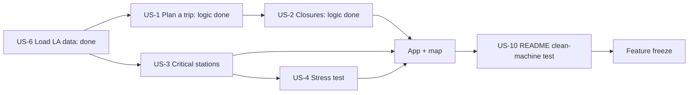

# Roadmap: how we build Metro Breakdown

This is the **how**: what each use case does, which files it touches, and how we know it's done.
The **status** (owner, hours, To Do / Done) lives in our backlog workbook in OneDrive:
`427-Metro-breakdown/MetroBreakdown_ProductBacklog.xlsx`. Story IDs (US-1, US-2, ...) are the same in both places.

> The workbook's task list was written before two decisions: we use **NetworkX's algorithms** (not
> hand-written ones) and we **build the network straight from GTFS** (no SQLite). Where the two
> disagree, follow this file.

---

## 1. Start here

**What we're building:** LA Metro's rail system as a network (stations = nodes, track between
stations = edges weighted by travel minutes), and an app that answers:

1. **Riders:** my station is closed. What's my new route, and how much longer is it?
2. **Planners:** which stations are single points of failure?
3. **Planners:** does the network survive random failures better than a targeted attack on its hubs?

**The demo story:**

1. Plan a normal trip: Downtown Long Beach to Union Station, 62 minutes.
2. Close Pershing Square: the trip still works, 3 minutes slower.
3. Close 7th St/Metro Center: **Unreachable.** One closed station cuts the network in two.
4. Show why: 95 of 111 stations are single points of failure, because the network has only 2 loops.
5. Compare random closures with targeted ones: targeting the hubs breaks the network much faster.

**Key dates (proposed; confirm at the next meeting):**

| Date | What |
|---|---|
| Mon Nov 30 | **Feature freeze.** Everything merged to `main`; README tested on a clean machine. |
| Dec 1-6 | Report, slides, two rehearsals, code walkthrough |
| Mon Dec 7 | **Everything submitted** (confirm the real due date with Prof. Nguyen) |

**Tech:** Python 3.11+, NetworkX, pytest. Streamlit + Plotly for the app.

**Setup:** follow the README's Getting started, then `python -m pytest -v`. Everything should pass.

---

## 2. Who owns what

| Role | Person | Owns |
|---|---|---|
| PM | Nathan Salazar | Repo, reviews, merges, integration, rehearsal |
| R1 Data | _TBD_ | `gtfs.py`, LA data checks, ridership data (US-5) |
| R2 Routing | Paula Awad (US-2 merged) | `rerouting.py`: trip planning and closures (US-1, US-2) |
| R3 Centrality | _TBD_ | `centrality.py`: critical stations (US-3) |
| R4 Resilience | _TBD_ | `resilience.py`: breakdown curves (US-4) |
| R5 App | _TBD_ | `app.py`: Streamlit app and map |
| R6 QA & Docs | _TBD_ | Tests, README clean-machine test, CITATIONS, report editing |

Everyone writes their own report section and presents their own part.

---

## 3. What blocks what



**Can start now, no waiting:** US-3 (critical stations), the app shell, CITATIONS.md, the report skeleton.

---

## 4. Use cases: how to build each one

Each use case lists its goal, status, files, steps, how we know it's done, tests, and evidence to save.
Station IDs are used everywhere in code (e.g. `"80122S"` on LA data, `"C"` on the sample); names are for display.

### UC-6: Load the LA Metro network (US-6) - done

**Goal:** turn LA Metro's published rail schedule into the network every other use case runs on.

**Files:** `src/metro/gtfs.py` (`load_network`), `scripts/fetch_gtfs.py`, `scripts/inspect_network.py`, `data/sample/gtfs/`

**How to use it:**
```bash
python scripts/fetch_gtfs.py        # download LA Metro's rail schedule to data/raw/
python scripts/inspect_network.py   # build the network and print a sanity report
```
```python
from metro.gtfs import load_network
G = load_network("data/raw/gtfs_rail.zip")       # or "data/sample/gtfs" for the test network
```

**Done:** 111 stations, 112 segments, 6 lines, 1 connected piece, no duplicate stations. Tests: `tests/test_gtfs.py`.

---

### UC-1: Plan a trip (US-1)

**Goal:** a rider picks two stations and sees the fastest route and its travel time.

**Status:** done. Logic in `rerouting.py` (`find_route`), app in the Trip planner tab.

**Files:** `src/metro/rerouting.py`, `app.py` (new)

**How to use it:**
```python
from metro.rerouting import find_route
path, minutes = find_route(G, "A", "I")   # sample: ['A','B','C','G','H','I'], 21 minutes
```
Returns `None` if no route exists. Raises `ValueError` for a station ID that isn't in the network.

**Steps:**
1. App: two dropdowns of station **names**; map each name to its ID with `{G.nodes[n]["name"]: n for n in G}`.
2. Show the minutes and the list of station names on the route.
3. Time one LA query (target: under 1 second) and note it in the workbook's Test Log.

**Done when:**
- [x] Sample route and minutes match the answer key
- [x] On LA data, Downtown Long Beach to Union Station shows 62 minutes and the station list in the app
- [x] Route drawn on the map

**Evidence:** screenshot of the normal trip (demo step 1).

---

### UC-2: Get around a closure (US-2)

**Goal:** a rider closes stations and sees the new route and how many minutes it adds, or "Unreachable".

**Status:** done. Logic in `rerouting.py` (`reroute`), app in the Trip planner tab; AC1-AC5 pass. Still needed: demo screenshots.

**How to use it:**
```python
from metro.rerouting import reroute
result = reroute(G, "A", "G", ["C"])      # closed stations are always a LIST of IDs
result["original"]        # (['A','B','C','G'], 10)
result["alternative"]     # (['A','B','D','G'], 13), or None if unreachable
result["extra_minutes"]   # 3, or None if either trip is impossible
```

**Steps:**
1. App: a multi-select of stations to close, then call `reroute`.
2. Show normal minutes, new minutes and "+N min", or "Unreachable" when `alternative` is `None`.
3. Map: closed stations in red, the new route highlighted (AC4).
4. LA demo (AC5): from Downtown Long Beach to Union Station, close Pershing Square (+3 min), then 7th St/Metro Center (Unreachable).

**Done when:**
- [x] AC1: closing Cedar Junction makes Alder to Ginkgo 13 min (+3)
- [x] AC2: closing Ginkgo makes Alder to Ivy unreachable
- [x] AC3: closing the start or end station shows unreachable
- [x] AC4: map shows closed stations in red and the new route
- [x] AC5: both LA closures above work in the app

**Tests:** `tests/test_rerouting.py`. **Evidence:** screenshots of the Pershing Square detour and the 7th St "Unreachable" (demo steps 2-3).

---

### UC-3: Find critical stations (US-3)

**Goal:** a planner sees which stations carry the most trips and which ones would split the network if closed.

**Status:** done. Logic in `centrality.py`, app in the Critical stations tab. Owner: R3.

**Files:** `src/metro/centrality.py` (new), `tests/test_centrality.py` (new)

**Steps:**
1. `top_stations(G, k)`: rank stations with `nx.betweenness_centrality(G, weight="weight")`; return the top k as (station_id, name, score). Ties are sorted by name.
2. `single_points_of_failure(G)`: `nx.articulation_points(G)` and `nx.bridges(G)`, returned as station IDs (the same as `rerouting.py`; the app looks up names).
3. `pieces_after_closing(G, station)`: `nx.connected_components(close_stations(G, [station]))`, largest first.
4. Docstrings explain betweenness and articulation points in plain words (Definition of Done).

**Sample-network answer key** (use `normalized=False` in the test so the scores are whole numbers):
- Betweenness: Cedar Junction 20, Birch 14, Ginkgo 14, then Alder, Dogwood, Hawthorn 8 each
- Articulation points: A, B, C, D, G, H
- Bridges: A-B, A-J, C-F, D-E, G-H, H-I

**Done when:**
- [x] Tests match the answer key above
- [x] On LA data the top 3 are Pico, 7th St/Metro Center and Willowbrook/Rosa Parks, in under 5 seconds (0.04 s)
- [x] App tab lists the top k and every single point of failure

**Evidence:** the LA top-10 table and the "95 of 111 stations are single points of failure" result, which counts stations only (the 100 bridges are segments). Demo step 4.

---

### UC-4: Stress-test the network (US-4)

**Goal:** compare random station failures with a targeted attack on the most important stations.

**Status:** done. Logic in `resilience.py`, app in the Stress test tab. Owner: R4.

**Files:** `src/metro/resilience.py` (new), `tests/test_resilience.py` (new)

**Steps:**
1. `breakdown_curve(G, k, strategy, seed=0)`: remove stations one at a time and record the share of stations still in the largest connected piece after each removal (`max(nx.connected_components(...), key=len)`).
2. Strategies: `"random"` (use `random.Random(seed)`, average 20 runs), `"degree"` (most connections first), `"betweenness"` (recompute each step, highest first).
3. App tab: pick k and a seed, plot the three curves on one chart.

**Done when:**
- [x] Curves have k+1 points and start at 1.0
- [x] Same seed gives the same random curve
- [x] On LA data, the betweenness attack drops faster than random (9% vs 43% after 10 closures)

**Evidence:** the three-curve chart for 10 removals (demo step 5).

---

### UC-5: Size the human impact (US-5, nice to have)

**Goal:** show how many daily riders a closure cuts off. Only if UC-1 to UC-4 are done by freeze.
Needs a citable source of weekday boardings per station (R1). Fallback: count the stations cut off.

---

### Team process: app, docs, and wrap-up

| What | Owner | Done when |
|---|---|---|
| `app.py`: Streamlit app with tabs for UC-1/2, UC-3, UC-4 and a Plotly map | R5 | `streamlit run app.py` works from a fresh clone |
| `CITATIONS.md`: data, libraries, tutorials | R6 | Every external source listed |
| README team table + each member's contributions | Everyone | All six names and what each built |
| US-10 clean-machine test | R6 | Someone who didn't write the README runs the app from it on Windows and Mac |
| Report (2 pages) and slides | Everyone | Each member writes their section; two timed rehearsals |

---

## 5. How to work a task

1. `git switch main` and `git pull`, then create a branch: `git switch -c feature/us3-centrality`.
2. Write the code **and its tests**. Use the sample network (`data/sample/gtfs`) so the answers are known.
3. Run `python -m pytest -v`. Everything passes.
4. Commit with a short, plain-English message. Push and open a pull request into `main`.
5. Nathan reviews against the acceptance criteria above, then merges.

**Git email:** set `git config --global user.email` to an email that's verified on your GitHub
account. Otherwise your commits don't count toward your contributions on GitHub.

---

## 6. Definition of Done

- [ ] All acceptance criteria for the story are met
- [ ] Tests on the sample network pass; merged to `main` through a reviewed PR
- [ ] Docstrings explain, in plain words, which NetworkX function is used and why
- [ ] Any tutorial, dataset or other outside help added to `CITATIONS.md`
- [ ] You can explain every line of your code out loud
